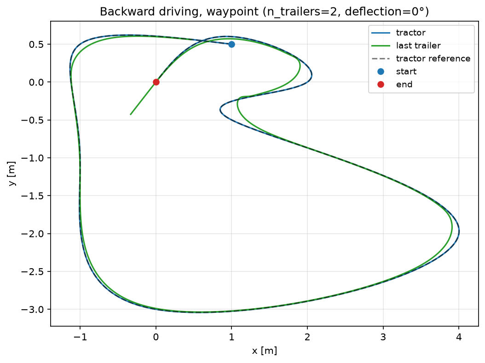
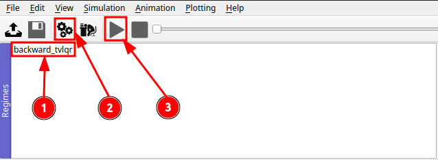

# n-trailer-lqr-control

Python simulation of a tractor pulling n trailers that drives **backward** along a
reference path, stabilized by a **time-varying LQR**. The repository contains:

- a symbolic kinematic model of the tractor + n-trailer chain (SymPy, any n),
  compiled to NumPy together with its Jacobians,
- a finite-horizon time-varying LQR whose Riccati differential equation is
  integrated backwards along the reference,
- a headless demo script and a PyMoskito GUI with an animated visualizer.

Code from my Bachelor's thesis in Mechatronics (University of Innsbruck / UMIT Tirol, 2025).
In the thesis, the controllers were also tested on a physical multi-trailer testbed (STM32, C++
lab code); that embedded code is not part of this repository.



*Output of `scripts/demo_backward_driving.py` with the default `scenario.yaml`
(2 trailers, waypoint spline, no initial deflection): tractor path (blue) and
last-trailer path (green) against the tractor reference (dashed), driving backward.*

Backward driving along a time-reversed reference. TV-LQR tracks the reference in
closed loop; the same motion open-loop is unstable (jackknifing).

## Install

```bash
pip install -e .
```

Requires Python 3.10+. For the GUI:

```bash
pip install -e ".[gui]"
```

## Quick Start

```bash
python scripts/demo_backward_driving.py   # writes results/backward_driving.png
```

## `scenario.yaml`

Geometry, trajectory, and initial perturbation. Both the demo script and the GUI
read this file. Commented examples for `bezier` and `circle` are in the file itself.

| Field | Meaning |
| ----- | ------- |
| `n_trailers` | Number of trailers (rebuilds symbolic model on next import) |
| `hitch_lengths_m` | Hitch lengths d₁…dₙ [m]; shorter lists repeat the last value |
| `axle_distances_m` | Axle distances l₂…lₙ₊₁ [m] |
| `deflection_deg` | Joint-angle offset at t=0 [deg] |
| `trajectory.type` | `waypoint`, `bezier`, or `circle` |
| `trajectory.T` | Simulation duration [s] — must match `end time` in `regimes/default.sreg` for the GUI |

The path is driven forward through the model, then reversed for backward driving.

## GUI

```bash
python scripts/run_gui.py
```

1. Select `backward_tvlqr` in **Regimes**
2. Click **Configure** (gear icon)
3. Click **Play**



## Tests

```bash
pip install -e ".[test]"
pytest
```

Smoke tests for the symbolic model and output map, plus a closed-loop check that
TV-LQR recovers from a 5° joint deflection while the open-loop run jackknifes.

## Thesis

A. Rief, *Lineare Ansätze zur Regelung eines Mehranhängersystems*.
Bachelor's thesis (B.Sc. Mechatronics), University of Innsbruck / UMIT Tirol, 2025 (German).
<!-- Thesis PDF: add link here once published. -->

## License

MIT — see [LICENSE](LICENSE).
